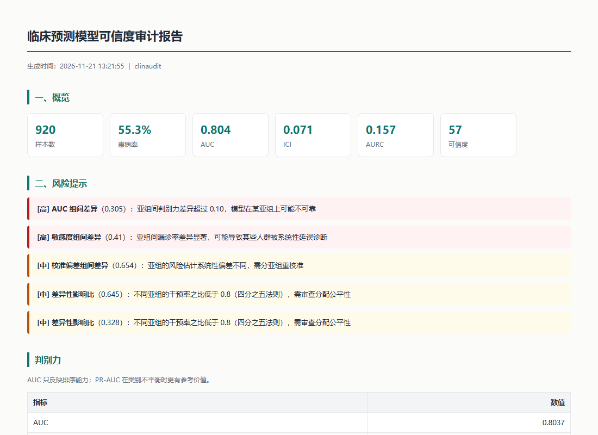

# clinaudit

**临床预测模型可信度审计工具**

[](https://www.python.org/)
[](LICENSE)
[](#测试)

---

## 这个工具解决什么问题

临床预测模型论文里最显眼的数字往往是 AUC。但 AUC 只回答"模型的排序对不对"，
不回答临床使用中真正要命的问题：

> **模型说这个病人有 30% 的风险，他的实际风险真的是 30% 吗？**

一个把所有风险系统性高估 20 个百分点的模型，AUC 可以很高，却会导致大规模过度治疗。
类似地，一个整体 AUC 0.90 的模型，可能在老年患者上只有 0.65。

`clinaudit` 把这类问题做成可自动化的审计，输出一份含**风险提示**的中文报告。



---

## 五个审计维度

| 维度 | 核心问题 | 主要指标 |
|---|---|---|
| **判别力** | 能不能区分阳性和阴性 | AUC、PR-AUC、敏感度、特异度 |
| **校准** | 预测概率准不准 | ICI、E50、E90、Brier、斜率/截距 |
| **公平性** | 各亚组是否一致 | AUC 差、敏感度差、差异性影响比 |
| **临床效用** | 用起来划不划算 | 决策曲线、净收益 |
| **风险控制** | 能不能识别不确定 | 选择性预测、AURC、Conformal 覆盖率 |

---

## 安装

```bash
git clone https://github.com/moon-star-art/clinaudit.git
cd clinaudit
python -m venv .venv

# Windows
.venv\Scripts\activate
# Linux / macOS
source .venv/bin/activate

pip install -e .
```

依赖：`numpy`、`pandas`、`scipy`、`scikit-learn`、`matplotlib`、`jinja2`。
**纯 CPU 即可运行**，不需要 GPU。

---

## 快速开始

### 一键审计（约 20 秒）

```bash
clinaudit demo
```

用 UCI 四中心心脏病数据训练模型并做全面审计，生成中文 HTML 报告。
**内置数据随包分发，首次运行无需联网。**

### 多中心外部验证

```bash
clinaudit external --train cleveland
```

```
中心               n     AUC     ICI     E50   Brier      斜率
----------------------------------------------------------------------------
cleveland      303   0.925   0.036   0.027   0.107    1.04
hungarian      294   0.867   0.149   0.160   0.164    1.09
switzerland    123   0.621   0.507   0.546   0.370    0.17
va             200   0.668   0.170   0.115   0.222    0.40
```

同一模型在 Cleveland 上 AUC 0.925，在 Switzerland 上只有 0.621，
校准误差 ICI 从 0.036 暴涨到 0.507。

### 重校准对比

```bash
clinaudit calibrate --data heart --method isotonic
```

### 单数据集审计

```bash
clinaudit audit --data pima --model gbdt --out report.html --json result.json
```

---

## 主要发现

基于 UCI 四中心心脏病数据（920 例）的实测结果。

### 1. 高 AUC 不等于可临床使用

| 中心 | n | 患病率 | AUC | ICI | 校准斜率 |
|---|---|---|---|---|---|
| Cleveland（训练） | 303 | 0.459 | **0.925** | **0.036** | 1.04 |
| Hungarian | 294 | 0.361 | 0.867 | 0.149 | 1.09 |
| Switzerland | 123 | **0.935** | **0.621** | **0.507** | **0.17** |
| VA | 200 | 0.745 | 0.668 | 0.170 | 0.40 |

Switzerland 的患病率是训练集的 2 倍，导致模型**严重低估**风险
（校准斜率 0.17 表示预测概率远不够极端），而这一缺陷在只看 AUC 时容易被忽略。

### 2. 重校准不能解决分布偏移

在训练集分布上做 Platt / Isotonic 重校准后，在 Switzerland 上验证：

| 方法 | ICI | E50 | Brier | 斜率 |
|---|---|---|---|---|
| 原始 | 0.846 | 0.880 | 0.788 | 0.34 |
| +Platt | **0.797** | 0.818 | 0.708 | 0.51 |
| +Isotonic | 0.841 | 0.824 | 0.782 | 0.04 |

改善非常有限。**重校准只能修正"校准问题"，无法修正"协变量分布不同"**。
真正需要的是目标中心的数据做本地验证。

### 3. 公平性会自动亮起红旗

四中心合并审计：

- AUC 组间差异 **0.305**（警戒线 0.10）
- 敏感度组间差异 **0.410**（警戒线 0.15）
- 差异性影响比 **0.645**（四分之五法则下限 0.80）

工具给出的评级为 **57/100，C（存在明显缺陷）**。

### 4. Conformal 预测的覆盖率达到理论保证

| α | 目标覆盖率 | 实测覆盖率 | 平均集合大小 |
|---|---|---|---|
| 0.05 | 0.95 | **0.9408** | 1.40 |
| 0.10 | 0.90 | **0.8947** | 1.20 |
| 0.20 | 0.80 | **0.8224** | 1.01 |

在有限样本下基本贴合 `1-α`，说明实现是正确的。

### 5. 不同分类器的校准表现差异明显

| 模型 | AUC | ICI | Brier | 斜率 | AURC |
|---|---|---|---|---|---|
| 逻辑回归 | 0.891 | 0.040 | 0.131 | 0.91 | 0.086 |
| 梯度提升 | 0.889 | **0.021** | 0.131 | **1.00** | 0.085 |
| 随机森林 | **0.895** | 0.065 | 0.131 | 1.37 | **0.082** |

三者的 AUC 几乎相同，但校准误差相差 3 倍。**选模型不能只看 AUC。**

---

## 项目结构

```
clinaudit/
├── src/clinaudit/
│   ├── data/loaders.py        # UCI 数据加载（多中心、缺失值感知）
│   ├── models/training.py     # 流水线封装、交叉验证、重校准
│   ├── metrics/
│   │   ├── discrimination.py  # AUC、PR-AUC、混淆矩阵
│   │   ├── calibration.py     # ICI/E50/E90、Brier 分解、DCA
│   │   ├── fairness.py        # 亚组比较、差异性影响
│   │   └── abstention.py      # 选择性预测、AURC、Conformal
│   ├── audit.py               # 审计流程编排与可信度评分
│   ├── report/                # 中文 HTML 报告与图表
│   ├── resources/heart/       # 内置四中心数据（离线可用）
│   └── cli.py
├── tests/                     # 134 个测试，覆盖率 90%
├── examples/run_benchmark.py
├── docs/METHODS.md
└── results/
```

---

## 适用与不适用

**适用**
- 自查自己的临床预测模型是否可靠
- 论文投稿前检查审稿人会问的校准/公平性问题
- 跨机构部署前的迁移性评估

**不适用**
- ❌ 不能替代外部验证研究
- ❌ 不能替代临床专家判断
- ❌ 内置数据集只有几百例，结论不应直接外推到真实临床

---

## 测试

```bash
pip install -e ".[dev]"
pytest --cov=clinaudit
```

```
134 passed in ~5s
TOTAL coverage: 90%
```

---

## 引用

```bibtex
@software{clinaudit2026,
  title  = {clinaudit: A toolkit for auditing the trustworthiness of
            clinical prediction models},
  author = {moon-star-art},
  year   = {2026},
  url    = {https://github.com/moon-star-art/clinaudit}
}
```

## 许可

MIT License，详见 [LICENSE](LICENSE)。

## 数据来源

[UCI Machine Learning Repository](https://archive.ics.uci.edu/)：
Heart Disease（ID 45）、Pima Diabetes（ID 34）、WDBC（ID 17）、ILPD（ID 225）。
四中心心脏病数据由 Cleveland Clinic Foundation、Hungarian Institute of Cardiology、
University Hospital Zurich、V.A. Medical Center Long Beach 采集。
